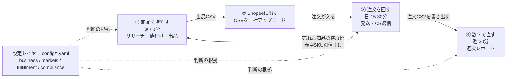
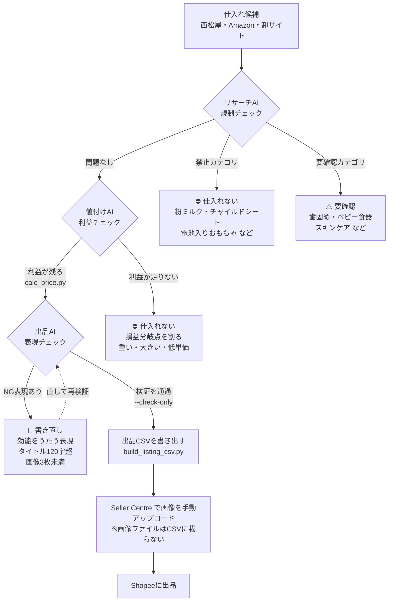
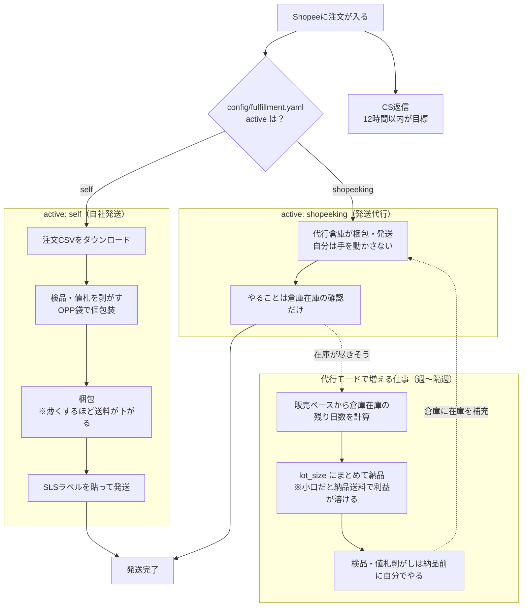
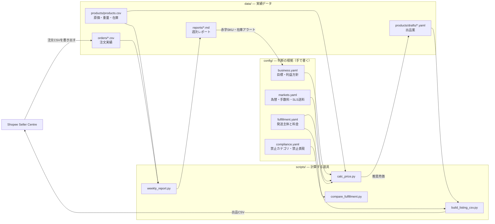
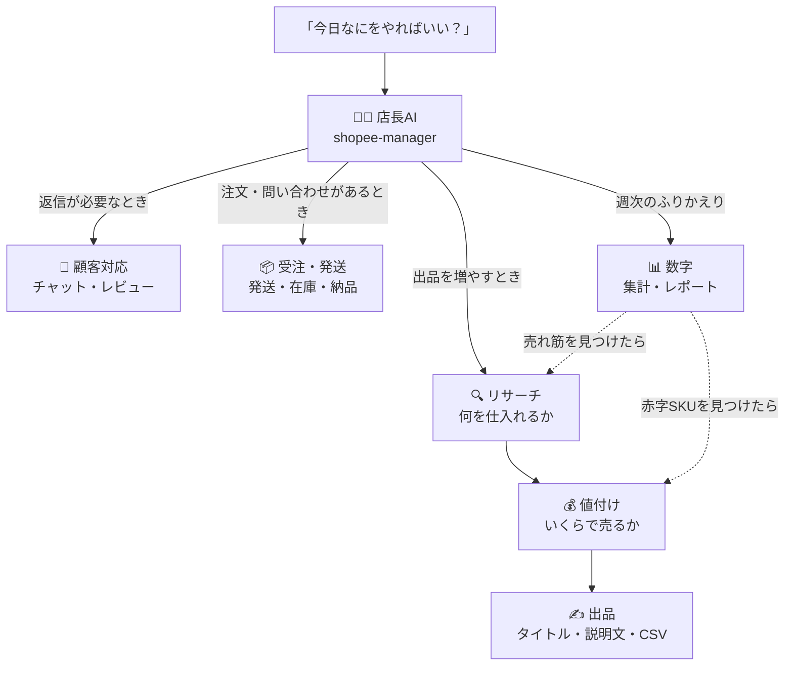

# 運用フロー図

オペレーションの全体像です。GitHub上ではそのまま図として表示されます。

---

## 1. 全体像：4つの工程がぐるぐる回る

このお店は「商品を増やす → Shopeeに出す → 注文を回す → 数字で直す」の4工程が
1周するだけの仕組みです。その下に、すべての判断の根拠になる**設定レイヤー**があります。



> 💡 **④から①に戻る矢印がこの仕組みの要です。** 売れた商品の色違いを足すのが、
> 一番確実な伸ばし方。新しい商品をゼロから探すより先にここを回してください。

---

## 2. 商品を増やす（①の詳細）：3箇所で止まる

仕入れ候補が出品に至るまでに、**3回ふるいにかけます。** どれかで止まったら引き返します。



**止まる場所と、止める理由**

| 止まる場所 | 何を見ているか | 止める理由 |
|---|---|---|
| リサーチAI | `config/compliance.yaml` の禁止・要確認カテゴリ | アカウント停止・法令違反を防ぐ |
| 値付けAI | 送料・手数料・為替込みの損益分岐点 | 「売れてるのに儲からない」を防ぐ |
| 出品AI | 禁止表現・文字数・画像枚数 | 薬機法的なNG表現とShopeeの弾きを防ぐ |
| 比較ツール | 発送代行の料金が未入力か | 「代行はタダ」という誤った結論を防ぐ |

---

## 3. 注文を回す（③の詳細）：発送モードで分岐する

`config/fulfillment.yaml` の `active` によって、**毎日の仕事がまるごと変わります。**



> ⚠️ **代行モードの唯一にして最大の事故は「倉庫の在庫切れ」です。**
> 手元に在庫があっても、倉庫に無ければ出荷できません。

**どちらを選ぶかは計算で決める**

```bash
python3 scripts/compare_fulfillment.py --sku BIB-001 --monthly-units 60
```

代行は「現金を払って時間を買う」取引なので、**空いた時間を時給いくらで買うことになるか**で判断します。

---

## 4. データの流れ：どのファイルがどこから来て、どこへ行くか



**手で書くのは `config/` と `data/products/products.csv` だけです。**
あとはAI社員がスクリプトを動かして作ります。

ただし **画像だけは例外**です。画像ファイルはCSVに載らないため、
CSVで商品を作ったあとに Seller Centre の商品編集画面で手動アップロードします。
写真は `data/products/images/<SKU>/` に置き、`build_listing_csv.py` が
サイズと並び順をチェックして手順書を書き出します。

---

## 5. 運用のリズム

| 頻度 | やること | 時間 | AI社員への一言 |
|---|---|---|---|
| **毎日** | 今日やることを3つに絞る | 5分 | 「今日なにをやればいい？」 |
| 毎日 | 発送（自社発送モードのみ） | 15分 | 「今日の発送分は？」 |
| 毎日 | チャット返信 | 10分 | 「このお客さんにどう返信する？」 |
| 毎日 | 新規出品（時間があれば） | 20分 | 「この商品を出品したい」 |
| **毎週** | ふりかえりと来週の打ち手 | 30分 | 「今週のふりかえりをして」 |
| 毎週〜隔週 | 倉庫への納品（代行モードのみ） | 30分 | 「倉庫に何個納品する？」 |
| **毎月** | 為替レートの更新 | 5分 | — （`config/markets.yaml` を直接編集） |
| 毎月 | 代行の料金改定・発送方法の再検討 | 10分 | 「代行に切り替えたほうが得？」 |

---

## 6. AI社員への振り分け

迷ったら店長AIに聞けば、適切な担当に振られます。


